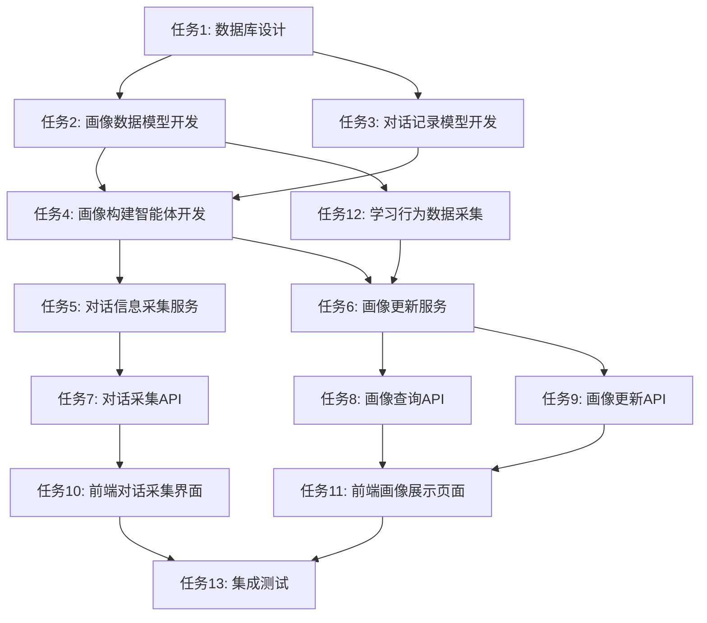

# 对话式学习画像系统 - 实施任务列表

## 任务概览

本 spec 实现对话式学习画像构建功能，包括自然语言对话信息采集、六维度画像建模、学习行为驱动更新和画像可视化展示。

## 任务依赖图

## 阶段一：数据层设计

### 任务 1: 数据库设计与创建

**描述**
设计学习画像相关的数据库表结构

**子任务**
1.1 设计学生画像主表
- 学生基本信息
- 六维度画像数据（知识基础、认知风格、学习进度、易错点偏好、兴趣方向、学习习惯）
- 画像版本管理

1.2 设计对话记录表
- 对话内容存储
- 对话轮次管理
- 信息提取结果

1.3 设计学习行为数据表
- 答题记录
- 资源浏览记录
- 学习路径完成记录

1.4 创建索引和约束
- 为高频查询字段创建索引
- 设置外键约束

**验收标准**
- [ ] 所有表结构创建成功
- [ ] 索引创建完成
- [ ] 表结构支持六维度画像存储
- [ ] 支持画像版本追溯

**依赖**
无

**预估工时**
4 小时

---

### 任务 2: 画像数据模型开发

**描述**
创建学习画像的实体类和数据访问层

**子任务**
2.1 创建 Java 实体类
- StudentProfile（学生画像主表）
- ProfileDimension（画像维度详情）
- ProfileHistory（画像历史版本）

2.2 创建 Mapper 接口
- 画像 CRUD 操作
- 画像版本查询
- 多维度数据查询

2.3 创建 Python 数据模型
- SQLAlchemy 模型定义
- Pydantic Schema 定义

**验收标准**
- [ ] Java 实体类和 Mapper 完成
- [ ] Python 数据模型完成
- [ ] 支持六维度数据结构化存储

**依赖**
任务 1

**预估工时**
6 小时

---

### 任务 3: 对话记录模型开发

**描述**
创建对话记录的数据模型

**子任务**
3.1 创建对话记录实体
- ConversationSession（对话会话）
- ConversationMessage（对话消息）
- ExtractedInfo（提取的信息）

3.2 创建数据访问层
- 对话记录存储
- 对话历史查询
- 信息提取结果管理

**验收标准**
- [ ] 对话记录模型完成
- [ ] 支持多轮对话管理
- [ ] 支持信息提取结果存储

**依赖**
任务 1

**预估工时**
4 小时

---

## 阶段二：智能体开发

### 任务 4: 画像构建智能体开发

**描述**
实现基于 LangGraph 的画像构建智能体

**子任务**
4.1 实现对话信息提取智能体
- 从自然语言对话中提取关键信息
- 识别六维度相关内容
- 结构化信息输出

4.2 实现画像建模智能体
- 基于提取信息生成画像
- 六维度数据量化
- 标签体系构建

4.3 实现画像更新智能体
- 基于学习行为更新画像
- 增量更新逻辑
- 画像版本管理

4.4 构建 LangGraph 编排流程
- 定义智能体节点
- 设置数据流转
- 实现状态管理

**验收标准**
- [ ] 对话信息提取准确率 > 85%
- [ ] 画像六维度完整生成
- [ ] 支持实时更新
- [ ] LangGraph 流程正常运行

**依赖**
任务 2, 任务 3

**预估工时**
20 小时

---

## 阶段三：业务服务开发

### 任务 5: 对话信息采集服务

**描述**
实现对话式信息采集的业务逻辑

**子任务**
5.1 实现对话会话管理
- 创建对话会话
- 管理对话轮次
- 会话状态跟踪

5.2 实现信息提取服务
- 调用画像构建智能体
- 提取结果验证
- 信息补全提示

5.3 实现对话引导逻辑
- 根据已采集信息生成引导问题
- 缺失维度提醒
- 对话完成判断

**验收标准**
- [ ] 对话会话管理正常
- [ ] 信息提取功能完整
- [ ] 对话引导合理

**依赖**
任务 4

**预估工时**
10 小时

---

### 任务 6: 画像更新服务

**描述**
实现学习画像的更新和维护逻辑

**子任务**
6.1 实现学习行为数据采集
- 监听答题事件
- 监听资源浏览事件
- 监听学习路径事件

6.2 实现画像实时更新
- 行为数据分析
- 画像维度调整
- 版本记录保存

6.3 实现画像手动调整
- 支持用户修改偏好
- 验证调整合理性
- 同步更新智能体

**验收标准**
- [ ] 学习行为实时采集
- [ ] 画像自动更新正常
- [ ] 支持手动调整

**依赖**
任务 4

**预估工时**
12 小时

---

### 任务 12: 学习行为数据采集

**描述**
实现学习行为数据的采集和处理

**子任务**
12.1 实现答题记录采集
- 答题正确率统计
- 易错知识点识别
- 答题时长分析

12.2 实现资源浏览采集
- 浏览时长统计
- 资源类型偏好分析
- 学习活跃度计算

12.3 实现学习路径采集
- 路径完成进度
- 学习节奏分析
- 知识点掌握度

**验收标准**
- [ ] 各类行为数据完整采集
- [ ] 数据分析准确
- [ ] 实时性满足要求

**依赖**
任务 2

**预估工时**
8 小时

---

## 阶段四：API 接口开发

### 任务 7: 对话采集 API

**描述**
实现对话信息采集的 API 接口

**子任务**
7.1 实现对话会话创建接口
- POST /api/v1/profile/conversation/start
- 返回会话 ID

7.2 实现对话消息发送接口
- POST /api/v1/profile/conversation/message
- 接收用户输入
- 返回系统引导问题

7.3 实现对话完成接口
- POST /api/v1/profile/conversation/complete
- 生成完整画像
- 返回画像摘要

**验收标准**
- [ ] API 接口功能正常
- [ ] 接口文档完整
- [ ] 参数验证正确

**依赖**
任务 5

**预估工时**
6 小时

---

### 任务 8: 画像查询 API

**描述**
实现学习画像查询的 API 接口

**子任务**
8.1 实现画像详情查询
- GET /api/v1/profile/{studentId}
- 返回六维度完整数据
- 返回可视化标签

8.2 实现画像历史查询
- GET /api/v1/profile/{studentId}/history
- 返回画像变更记录
- 支持版本对比

8.3 实现画像摘要查询
- GET /api/v1/profile/{studentId}/summary
- 返回关键指标
- 返回学习特征概述

**验收标准**
- [ ] 查询接口功能完整
- [ ] 数据格式规范
- [ ] 性能满足要求

**依赖**
任务 6

**预估工时**
5 小时

---

### 任务 9: 画像更新 API

**描述**
实现学习画像更新的 API 接口

**子任务**
9.1 实现手动调整接口
- PUT /api/v1/profile/{studentId}/adjust
- 支持偏好修改
- 验证调整合理性

9.2 实现行为数据上报接口
- POST /api/v1/profile/behavior
- 接收学习行为数据
- 触发画像更新

**验收标准**
- [ ] 更新接口功能正常
- [ ] 数据验证完整
- [ ] 更新实时生效

**依赖**
任务 6

**预估工时**
4 小时

---

## 阶段五：前端开发

### 任务 10: 前端对话采集界面

**描述**
实现对话式信息采集的前端界面

**子任务**
10.1 实现对话界面布局
- 对话气泡展示
- 输入框设计
- 进度提示

10.2 实现对话交互逻辑
- 消息发送
- 实时响应
- 引导问题展示

10.3 实现信息采集进度展示
- 六维度采集状态
- 完成度提示
- 缺失信息提醒

**验收标准**
- [ ] 界面布局美观
- [ ] 交互流畅
- [ ] 进度展示清晰

**依赖**
任务 7

**预估工时**
10 小时

---

### 任务 11: 前端画像展示页面

**描述**
实现学习画像可视化展示页面

**子任务**
11.1 实现六维度雷达图
- 数据可视化
- 维度对比
- 交互提示

11.2 实现标签云展示
- 个人学习标签
- 标签权重展示
- 标签筛选

11.3 实现画像详情展示
- 各维度详细数据
- 学习行为统计
- 历史变更记录

11.4 实现手动调整功能
- 偏好设置表单
- 实时预览
- 保存确认

**验收标准**
- [ ] 可视化效果良好
- [ ] 数据展示完整
- [ ] 调整功能正常

**依赖**
任务 8, 任务 9

**预估工时**
12 小时

---

## 阶段六：测试与优化

### 任务 13: 集成测试

**描述**
完整流程的集成测试

**子任务**
13.1 对话采集流程测试
- 完整对话流程
- 信息提取准确性
- 画像生成正确性

13.2 画像更新流程测试
- 学习行为触发更新
- 更新实时性
- 数据一致性

13.3 性能测试
- 对话响应时间
- 画像查询性能
- 并发处理能力

13.4 用户体验测试
- 界面易用性
- 交互流畅度
- 错误提示友好性

**验收标准**
- [ ] 所有功能测试通过
- [ ] 性能指标达标
- [ ] 用户体验良好

**依赖**
任务 10, 任务 11

**预估工时**
8 小时

---

## 总计

**总任务数：** 13 个
**预估总工时：** 109 小时
**关键路径：** 任务1 → 任务2 → 任务4 → 任务6 → 任务9 → 任务11 → 任务13
