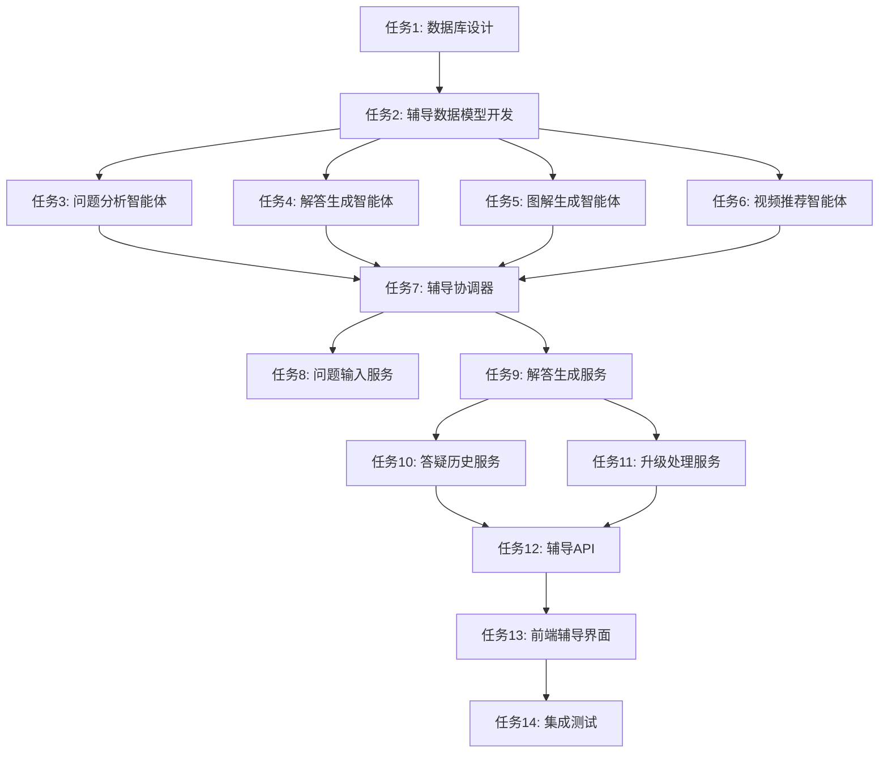

# 智能辅导系统 - 实施任务列表

## 任务概览

本 spec 实现智能辅导功能，包括多模态问题提问、实时多模态解答、答疑历史记录和疑难问题人工兜底。

## 任务依赖图

## 阶段一：数据层设计

### 任务 1: 数据库设计与创建

**描述**
设计智能辅导相关的数据库表结构

**子任务**
1.1 设计问题表
- 问题内容（文字+图片）
- 学生信息
- 问题状态

1.2 设计解答表
- 解答内容（文字+图解+视频）
- 解答来源（AI/人工）
- 置信度

1.3 设计答疑会话表
- 会话管理
- 多轮对话
- 会话状态

1.4 设计升级记录表
- 升级原因
- 处理状态
- 人工解答

**验收标准**
- [x] 所有表结构创建成功
- [x] 支持多模态内容存储
- [x] 支持会话管理
- [x] 索引创建完成

**依赖**
无

**预估工时**
4 小时

---

### 任务 2: 辅导数据模型开发

**描述**
创建智能辅导的实体类和数据访问层

**子任务**
2.1 创建 Java 实体类
- TutoringQuestion（问题）
- TutoringAnswer（解答）
- TutoringSession（会话）
- EscalationRecord（升级记录）

2.2 创建 Mapper 接口
- 问题 CRUD 操作
- 解答管理
- 会话管理
- 升级记录管理

2.3 创建 Python 数据模型
- SQLAlchemy 模型
- Pydantic Schema

**验收标准**
- [x] Java 实体类和 Mapper 完成
- [x] Python 数据模型完成
- [x] 支持多模态数据结构

**依赖**
任务 1

**预估工时**
6 小时

---

## 阶段二：智能体开发

### 任务 3: 问题分析智能体

**描述**
实现问题分析和分类智能体

**子任务**
3.1 实现问题理解
- 文字问题解析
- 图片问题识别（OCR + 多模态模型）
- 问题意图识别

3.2 实现问题分类
- 知识点识别
- 问题类型分类
- 难度评估

3.3 实现问题扩展
- 补充背景信息
- 关联知识点
- 相似问题检索

**验收标准**
- [x] 问题理解准确
- [x] 分类正确率 > 85%
- [x] 图片识别准确

**依赖**
任务 2

**预估工时**
14 小时

---

### 任务 4: 解答生成智能体

**描述**
实现文字解答生成智能体

**子任务**
4.1 实现 RAG 检索
- 检索相关知识
- 检索相似问题解答
- 结果排序

4.2 实现解答生成
- 基于检索结果生成解答
- Markdown 格式输出
- 支持 LaTeX 公式

4.3 实现个性化调整
- 根据学生画像调整
- 调整详细程度
- 调整表达风格

4.4 实现知识来源标注
- 标注参考资料
- 添加资源链接
- 可信度标识

**验收标准**
- [x] 解答生成准确
- [x] 个性化效果明显
- [x] 来源标注完整

**依赖**
任务 2

**预估工时**
16 小时

---

### 任务 5: 图解生成智能体

**描述**
实现逻辑图解生成智能体

**子任务**
5.1 实现图解需求判断
- 判断是否需要图解
- 识别图解类型
- 确定图解内容

5.2 实现 Mermaid 代码生成
- 生成流程图
- 生成思维导图
- 生成时序图

5.3 实现图解优化
- 布局优化
- 可读性提升
- 样式美化

**验收标准**
- [x] 图解生成准确
- [x] 图解类型合适
- [x] 可视化效果好

**依赖**
任务 2

**预估工时**
12 小时

---

### 任务 6: 视频推荐智能体

**描述**
实现视频讲解推荐智能体

**子任务**
6.1 实现视频检索
- 基于知识点检索
- 基于问题类型检索
- 相关性排序

6.2 实现推荐策略
- 考虑学生画像
- 考虑学习偏好
- 多样性控制

6.3 实现视频片段定位
- 定位相关片段
- 生成时间戳
- 添加说明

**验收标准**
- [x] 视频检索准确
- [x] 推荐效果好
- [x] 片段定位准确

**依赖**
任务 2

**预估工时**
10 小时

---

### 任务 7: 辅导协调器

**描述**
实现多智能体协同的辅导协调器

**子任务**
7.1 实现 LangGraph 编排
- 定义智能体节点
- 设置协同流程
- 状态管理

7.2 实现置信度评估
- 评估解答质量
- 计算置信度分数
- 升级判断

7.3 实现结果聚合
- 聚合各智能体结果
- 格式统一
- 质量检查

**验收标准**
- [x] 协调器正常运行
- [x] 置信度评估准确
- [x] 结果聚合完整

**依赖**
任务 3, 任务 4, 任务 5, 任务 6

**预估工时**
12 小时

---

## 阶段三：业务服务开发

### 任务 8: 问题输入服务

**描述**
实现问题输入的业务逻辑

**子任务**
8.1 实现问题接收
- 接收文字问题
- 接收图片问题
- 参数验证

8.2 实现图片处理
- 图片上传到对象存储
- 图片格式验证
- 图片大小限制

8.3 实现问题预处理
- 敏感词过滤
- 格式规范化
- 问题去重

**验收标准**
- [x] 问题接收正常
- [x] 图片处理稳定
- [x] 预处理完整

**依赖**
任务 7

**预估工时**
8 小时

---

### 任务 9: 解答生成服务

**描述**
实现解答生成的业务逻辑

**子任务**
9.1 实现异步生成
- Celery 任务定义
- 调用辅导协调器
- 进度跟踪

9.2 实现实时推送
- WebSocket 推送
- 流式输出
- 完成通知

9.3 实现解答保存
- 保存到数据库
- 保存多模态内容
- 索引更新

9.4 实现解答评价
- 接收用户评价
- 记录评价数据
- 反馈给智能体

**验收标准**
- [x] 异步生成稳定
- [x] 实时推送流畅
- [x] 解答保存完整
- [x] 评价功能正常

**依赖**
任务 7

**预估工时**
14 小时

---

### 任务 10: 答疑历史服务

**描述**
实现答疑历史管理的业务逻辑

**子任务**
10.1 实现历史记录查询
- 按时间查询
- 按知识点查询
- 按关键词搜索

10.2 实现历史记录管理
- 查看详情
- 收藏记录
- 删除记录

10.3 实现 Elasticsearch 集成
- 全文检索
- 相似问题推荐
- 搜索结果排序

**验收标准**
- [x] 查询功能完整
- [x] 管理功能正常
- [x] 搜索准确快速

**依赖**
任务 9

**预估工时**
10 小时

---

### 任务 11: 升级处理服务

**描述**
实现疑难问题升级处理的业务逻辑

**子任务**
11.1 实现自动升级触发
- 置信度低于阈值
- 生成超时
- 用户主动请求

11.2 实现人工分配
- 选择合适专家
- 任务分配
- 通知专家

11.3 实现人工解答处理
- 接收人工解答
- 保存解答
- 通知学生

11.4 实现反馈机制
- 反馈给 AI 服务
- 用于模型优化
- 知识库更新

**验收标准**
- [x] 升级触发准确
- [x] 分配逻辑合理
- [x] 处理流程完整
- [x] 反馈机制有效

**依赖**
任务 9

**预估工时**
12 小时

---

## 阶段四：API 接口开发

### 任务 12: 辅导 API

**描述**
实现智能辅导的 API 接口

**子任务**
12.1 实现问题提交接口
- POST /api/v1/tutoring/question
- 支持文字+图片
- 返回问题 ID

12.2 实现解答查询接口
- GET /api/v1/tutoring/answer/{questionId}
- 返回完整解答
- 返回生成状态

12.3 实现历史查询接口
- GET /api/v1/tutoring/history
- 支持多条件筛选
- 分页查询

12.4 实现评价接口
- POST /api/v1/tutoring/evaluate
- 接收评分和反馈
- 记录评价

12.5 实现升级接口
- POST /api/v1/tutoring/escalate
- 触发人工升级
- 返回预计响应时间

**验收标准**
- [x] 所有接口功能正常
- [x] 参数验证完整
- [x] 接口文档完整

**依赖**
任务 10, 任务 11

**预估工时**
8 小时

---

## 阶段五：前端开发

### 任务 13: 前端辅导界面

**描述**
实现智能辅导的前端界面

**子任务**
13.1 实现问题提交界面
- 文字输入框
- 图片上传
- 提交按钮

13.2 实现解答展示界面
- Markdown 渲染
- Mermaid 图表渲染
- LaTeX 公式渲染
- 代码高亮
- 视频播放

13.3 实现答疑历史界面
- 历史列表
- 搜索筛选
- 详情查看

13.4 实现评价功能
- 评分组件
- 反馈输入
- 提交评价

13.5 实现实时交互
- WebSocket 连接
- 流式内容展示
- 加载动画

**验收标准**
- [x] 提交界面友好
- [x] 解答渲染正确
- [x] 历史管理方便
- [x] 评价功能完整
- [x] 实时交互流畅

**依赖**
任务 12

**预估工时**
16 小时

---

## 阶段六：测试与优化

### 任务 14: 集成测试

**描述**
完整流程的集成测试

**子任务**
14.1 辅导流程测试
- 问题提交测试
- 解答生成测试
- 多模态内容测试

14.2 历史管理测试
- 查询功能测试
- 搜索功能测试
- 管理功能测试

14.3 升级流程测试
- 自动升级测试
- 人工处理测试
- 反馈机制测试

14.4 性能测试
- 解答生成速度
- 并发处理能力
- 实时推送性能

**验收标准**
- [x] 所有功能测试通过
- [ ] 性能指标达标
- [ ] 用户体验良好

**依赖**
任务 13

**预估工时**
10 小时

---

## 总计

**总任务数：** 14 个
**预估总工时：** 152 小时
**关键路径：** 任务1 → 任务2 → 任务3-6 → 任务7 → 任务9 → 任务12 → 任务13 → 任务14
