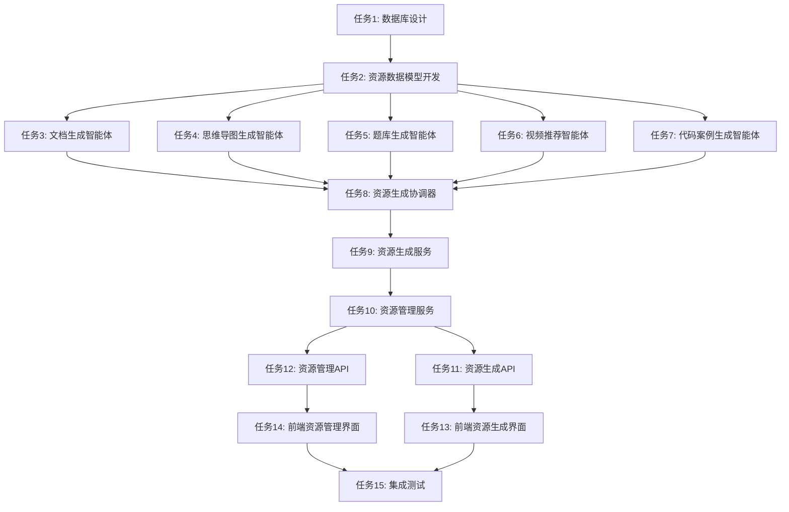

# 多智能体协同资源生成系统 - 实施任务列表

## 任务概览

本 spec 实现多智能体协同的个性化学习资源生成功能，包括五类资源生成（课程讲解文档、知识点思维导图、分层练习题库、教学视频/动画、代码实操案例）、资源管理和质量控制。

## 任务依赖图

## 阶段一：数据层设计

### 任务 1: 数据库设计与创建

**描述**
设计学习资源相关的数据库表结构

**子任务**
1.1 设计资源主表
- 资源基本信息
- 资源类型（文档、导图、题库、视频、代码）
- 资源状态（生成中、已完成、已收藏）

1.2 设计资源生成任务表
- 任务队列管理
- 生成参数记录
- 任务状态跟踪

1.3 设计资源内容表
- 分类型存储资源内容
- 支持多模态数据
- 版本管理

1.4 设计资源收藏表
- 用户收藏关系
- 收藏分类
- 收藏时间

**验收标准**
- [x] 所有表结构创建成功（见 `sql/tj_learning_resource.sql`）
- [x] 支持五类资源存储
- [x] 支持资源版本管理（主表 `version` 字段）
- [x] 索引创建完成

**依赖**
无

**预估工时**
5 小时

---

### 任务 2: 资源数据模型开发

**描述**
创建学习资源的实体类和数据访问层

**子任务**
2.1 创建 Java 实体类
- LearningResource（资源主表）
- ResourceGenerationTask（生成任务）
- ResourceContent（资源内容）
- ResourceFavorite（收藏记录）

2.2 创建 Mapper 接口
- 资源 CRUD 操作
- 任务队列管理
- 收藏管理

2.3 创建 Python 数据模型
- SQLAlchemy 模型
- Pydantic Schema

**验收标准**
- [x] Java 实体类和 Mapper 完成（`a3-learning` 模块）
- [x] Python 数据模型完成（`app/schemas/resource.py`；PostgreSQL 模型见 `app/db/models/generated_resource.py`）
- [x] 支持五类资源数据结构

**依赖**
任务 1

**预估工时**
6 小时

---

## 阶段二：智能体开发

### 任务 3: 文档生成智能体

**描述**
实现课程讲解文档生成智能体

**子任务**
3.1 实现文档内容生成
- 基于知识点生成讲解内容
- Markdown 格式输出
- 支持 LaTeX 公式

3.2 实现个性化调整
- 根据学生画像调整难度
- 根据学习偏好调整风格
- 补充相关知识点

3.3 实现质量控制
- 内容完整性检查
- 知识准确性验证
- 格式规范性检查

**验收标准**
- [ ] 文档生成功能正常
- [ ] 个性化效果明显
- [ ] 内容质量达标

**依赖**
任务 2

**预估工时**
12 小时

---

### 任务 4: 思维导图生成智能体

**描述**
实现知识点思维导图生成智能体

**子任务**
4.1 实现知识点结构分析
- 提取知识点层次
- 识别知识点关系
- 构建知识图谱

4.2 实现 Mermaid 代码生成
- 生成思维导图代码
- 优化布局结构
- 添加样式配置

4.3 实现导图优化
- 节点数量控制
- 层级深度优化
- 可读性提升

**验收标准**
- [ ] 思维导图生成正常
- [ ] 知识结构清晰
- [ ] 可视化效果良好

**依赖**
任务 2

**预估工时**
10 小时

---

### 任务 5: 题库生成智能体

**描述**
实现分层练习题库生成智能体

**子任务**
5.1 实现题目生成
- 基础层题目生成
- 进阶层题目生成
- 拔高层题目生成

5.2 实现题目质量控制
- 难度评估
- 知识点覆盖检查
- 答案准确性验证

5.3 实现题目多样化
- 题型多样性
- 考点分布均衡
- 避免重复

**验收标准**
- [ ] 三层题目生成正常
- [ ] 题目质量达标
- [ ] 难度分层合理

**依赖**
任务 2

**预估工时**
14 小时

---

### 任务 6: 视频推荐智能体

**描述**
实现教学视频/动画推荐智能体

**子任务**
6.1 实现视频检索
- 从资源库检索相关视频
- 基于知识点匹配
- 相关性排序

6.2 实现推荐算法
- 根据学生画像推荐
- 考虑学习偏好
- 多样性控制

6.3 实现视频元数据管理
- 视频标签管理
- 知识点映射
- 质量评分

**验收标准**
- [ ] 视频检索准确
- [ ] 推荐效果良好
- [ ] 元数据完整

**依赖**
任务 2

**预估工时**
8 小时

---

### 任务 7: 代码案例生成智能体

**描述**
实现代码实操案例生成智能体

**子任务**
7.1 实现代码生成
- 根据知识点生成示例代码
- 支持多种编程语言
- 添加详细注释

7.2 实现代码质量控制
- 语法正确性检查
- 代码规范性检查
- 可运行性验证

7.3 实现案例说明生成
- 生成案例说明文档
- 添加运行步骤
- 提供预期输出

**验收标准**
- [ ] 代码生成正确
- [ ] 代码可运行
- [ ] 说明文档完整

**依赖**
任务 2

**预估工时**
12 小时

---

### 任务 8: 资源生成协调器

**描述**
实现多智能体协同的资源生成协调器

**子任务**
8.1 实现 LangGraph 编排
- 定义智能体节点
- 设置协同流程
- 状态管理

8.2 实现任务分发
- 根据资源类型分发任务
- 并行生成控制
- 任务优先级管理

8.3 实现结果聚合
- 收集各智能体结果
- 结果格式统一
- 质量综合评估

**验收标准**
- [ ] 协调器正常运行
- [ ] 多智能体协同顺畅
- [ ] 资源生成效率高

**依赖**
任务 3, 任务 4, 任务 5, 任务 6, 任务 7

**预估工时**
10 小时

---

## 阶段三：业务服务开发

### 任务 9: 资源生成服务

**描述**
实现资源生成的业务逻辑

**子任务**
9.1 实现生成任务创建
- 接收生成请求
- 参数验证
- 任务入队

9.2 实现异步生成处理
- Celery 任务定义
- 调用资源生成协调器
- 进度跟踪

9.3 实现流式输出
- 支持生成过程预览
- 实时推送进度
- 完成通知

9.4 实现生成结果保存
- 保存到数据库
- 上传到对象存储
- 索引更新

**验收标准**
- [x] 生成任务正常创建
- [x] 异步处理主流程已打通（当前为应用内异步任务，未接 Celery）
- [x] 实时进度已支持 WebSocket 推送，前端保留轮询兜底
- [x] 结果保存完整，且已补对象存储上传兜底链路

**依赖**
任务 8

**预估工时**
12 小时

---

### 任务 10: 资源管理服务

**描述**
实现资源管理的业务逻辑

**子任务**
10.1 实现资源查询
- 按类型查询
- 按知识点查询
- 按时间查询
- 全文检索

10.2 实现资源收藏
- 添加收藏
- 取消收藏
- 收藏分类
- 收藏列表

10.3 实现资源下载
- 生成下载链接
- 格式转换
- 批量下载

10.4 实现资源删除
- 软删除
- 权限验证
- 级联删除

**验收标准**
- [x] 查询功能完整
- [x] 收藏功能正常
- [x] 下载功能已支持对象存储优先与失败回退，批量下载为真实 ZIP
- [x] 删除功能已具备权限校验与软删/硬删分支

**依赖**
任务 9

**预估工时**
10 小时

---

## 阶段四：API 接口开发

### 任务 11: 资源生成 API

**描述**
实现资源生成的 API 接口

**子任务**
11.1 实现生成请求接口
- POST /api/v1/resource/generate
- 支持五类资源选择
- 参数验证

11.2 实现进度查询接口
- GET /api/v1/resource/task/{taskId}
- 返回生成进度
- 返回预览内容

11.3 实现 WebSocket 推送
- 实时推送生成进度
- 推送完成通知
- 推送错误信息

**验收标准**
- [x] API 接口功能正常
- [x] WebSocket 推送已落地到资源生成任务流
- [ ] 接口文档完整

**依赖**
任务 9

**预估工时**
8 小时

---

### 任务 12: 资源管理 API

**描述**
实现资源管理的 API 接口

**子任务**
12.1 实现资源列表接口
- GET /api/v1/resource/list
- 支持多条件筛选
- 分页查询

12.2 实现资源详情接口
- GET /api/v1/resource/{resourceId}
- 返回完整内容
- 返回元数据

12.3 实现收藏管理接口
- POST /api/v1/resource/favorite
- DELETE /api/v1/resource/favorite/{id}
- GET /api/v1/resource/favorites

12.4 实现下载接口
- GET /api/v1/resource/download/{resourceId}
- 生成临时下载链接
- 支持格式选择

**验收标准**
- [x] 所有接口核心功能已实现
- [x] 参数验证基本完整
- [ ] 接口文档完整

**依赖**
任务 10

**预估工时**
8 小时

---

## 阶段五：前端开发

### 任务 13: 前端资源生成界面

**描述**
实现资源生成的前端界面

**子任务**
13.1 实现资源类型选择
- 五类资源卡片展示
- 资源说明
- 快捷选择

13.2 实现生成参数配置
- 知识点选择
- 难度设置
- 个性化选项

13.3 实现生成进度展示
- 进度条显示
- 流式内容预览
- 完成提示

13.4 实现生成结果展示
- 内容渲染
- 下载按钮
- 收藏按钮

**验收标准**
- [x] 界面可用并完成任务创建主流程
- [x] 交互主链路已打通
- [x] 进度展示已支持 WebSocket 实时更新与轮询兜底
- [ ] 内容渲染正确（仍待更细粒度预览验收）

**依赖**
任务 11

**预估工时**
14 小时

---

### 任务 14: 前端资源管理界面

**描述**
实现资源管理的前端界面

**子任务**
14.1 实现资源列表页
- 资源卡片展示
- 筛选器
- 搜索框
- 分页控件

14.2 实现资源详情页
- 内容完整展示
- Markdown 渲染
- Mermaid 渲染
- 代码高亮

14.3 实现收藏夹页面
- 收藏列表
- 分类管理
- 批量操作

14.4 实现资源操作
- 在线查看
- 下载
- 收藏/取消收藏
- 删除

**验收标准**
- [x] 列表页核心功能已实现
- [x] 详情页基础渲染已实现
- [x] 收藏夹功能正常
- [ ] 操作交互流畅

**依赖**
任务 12

**预估工时**
16 小时

---

## 阶段六：测试与优化

### 任务 15: 集成测试

**描述**
完整流程的集成测试

**进展（部分）**：Python `app/tests/test_multi_agent_resource_generation_integration.py` 已覆盖任务、查询、收藏、删除、WebSocket 进度、对象存储下载回退、批量 ZIP 下载；详见 `PROGRESS.md`。网关与真实依赖链仍待补充。

**子任务**
15.1 资源生成流程测试
- 五类资源生成测试
- 个性化效果验证
- 质量评估

15.2 资源管理流程测试
- 查询功能测试
- 收藏功能测试
- 下载功能测试

15.3 性能测试
- 生成速度测试
- 并发处理测试
- 资源加载性能

15.4 用户体验测试
- 界面易用性
- 交互流畅度
- 错误处理

**验收标准**
- [x] 资源模块当前自动化测试通过（最近一次为 `23 passed`）
- [ ] 性能指标达标
- [ ] 用户体验良好

**依赖**
任务 13, 任务 14

**预估工时**
10 小时

---

## 总计

**总任务数：** 15 个
**预估总工时：** 155 小时
**关键路径：** 任务1 → 任务2 → 任务3-7 → 任务8 → 任务9 → 任务11 → 任务13 → 任务15
