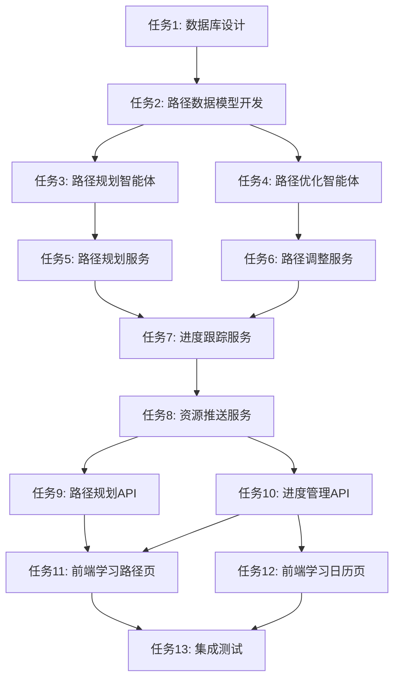

# 个性化学习路径规划系统 - 实施任务列表

## 任务概览

本 spec 实现个性化学习路径规划功能，包括阶梯式路径自动规划、节点资源推送、学习进度跟踪和路径动态优化。

## 任务依赖图

## 阶段一：数据层设计

### 任务 1: 数据库设计与创建

**描述**
设计学习路径相关的数据库表结构

**子任务**
1.1 设计学习路径主表
- 路径基本信息
- 学生关联
- 路径状态

1.2 设计路径节点表
- 节点顺序
- 知识点关联
- 节点类型（学习、练习、测评）
- 完成条件

1.3 设计节点资源关联表
- 节点与资源映射
- 推送状态
- 推送时间

1.4 设计学习进度表
- 节点完成状态
- 学习时长
- 完成时间

**验收标准**
- [x] 所有表结构创建成功
- [x] 支持阶梯式路径存储
- [x] 支持进度追踪
- [x] 索引创建完成

**依赖**
无

**预估工时**
4 小时

---

### 任务 2: 路径数据模型开发

**描述**
创建学习路径的实体类和数据访问层

**子任务**
2.1 创建 Java 实体类
- LearningPath（学习路径）
- PathNode（路径节点）
- NodeResource（节点资源）
- LearningProgress（学习进度）

2.2 创建 Mapper 接口
- 路径 CRUD 操作
- 节点管理
- 进度跟踪

2.3 创建 Python 数据模型
- SQLAlchemy 模型
- Pydantic Schema

**验收标准**
- [x] Java 实体类和 Mapper 完成
- [x] Python 数据模型完成
- [~] 支持路径树形结构

**依赖**
任务 1

**预估工时**
6 小时

---

## 阶段二：智能体开发

### 任务 3: 路径规划智能体

**描述**
实现基于学生画像的学习路径规划智能体

**子任务**
3.1 实现知识点依赖分析
- 提取知识点前置关系
- 构建知识图谱
- 确定学习顺序

3.2 实现路径生成
- 基于学生画像规划路径
- 设置阶段目标
- 分配节点任务

3.3 实现难度分层
- 根据知识掌握度设置难度
- 阶梯式难度递增
- 适应性调整

3.4 实现资源匹配
- 为每个节点匹配资源
- 考虑学习偏好
- 多样性控制

**验收标准**
- [~] 路径规划逻辑合理
- [~] 知识点顺序正确
- [~] 难度分层适当
- [~] 资源匹配准确

**依赖**
任务 2

**预估工时**
16 小时

---

### 任务 4: 路径优化智能体

**描述**
实现基于学习效果的路径动态优化智能体

**子任务**
4.1 实现学习效果分析
- 分析练习测评结果
- 识别薄弱知识点
- 评估学习效率

4.2 实现路径调整策略
- 增加薄弱知识点节点
- 调整后续难度
- 重新排序节点

4.3 实现调整建议生成
- 生成调整原因说明
- 提供调整预览
- 用户确认机制

**验收标准**
- [~] 效果分析准确
- [~] 调整策略合理
- [~] 建议说明清晰

**依赖**
任务 2

**预估工时**
12 小时

---

## 阶段三：业务服务开发

### 任务 5: 路径规划服务

**描述**
实现学习路径规划的业务逻辑

**子任务**
5.1 实现路径创建
- 获取学生画像
- 调用路径规划智能体
- 保存路径数据

5.2 实现路径预览
- 生成路径可视化数据
- 展示节点详情
- 预估学习时长

5.3 实现路径确认
- 用户确认路径
- 激活路径
- 初始化进度

**验收标准**
- [x] 路径创建功能正常
- [x] 预览数据完整
- [x] 确认流程顺畅

**依赖**
任务 3

**预估工时**
10 小时

---

### 任务 6: 路径调整服务

**描述**
实现学习路径动态调整的业务逻辑

**子任务**
6.1 实现自动调整触发
- 监听测评结果
- 分析学习效率
- 触发调整评估

6.2 实现调整执行
- 调用路径优化智能体
- 生成调整方案
- 应用调整

6.3 实现手动调整
- 支持用户暂缓节点
- 支持跳过节点
- 支持重做节点

**验收标准**
- [~] 自动调整及时
- [~] 调整方案合理
- [~] 手动调整灵活

**依赖**
任务 4

**预估工时**
10 小时

---

### 任务 7: 进度跟踪服务

**描述**
实现学习进度跟踪的业务逻辑

**子任务**
7.1 实现进度记录
- 记录节点开始时间
- 记录学习时长
- 记录完成时间

7.2 实现进度计算
- 计算整体完成度
- 计算阶段完成度
- 预估剩余时间

7.3 实现进度同步
- 实时更新进度
- 同步到前端
- 推送进度提醒

**验收标准**
- [x] 进度记录准确
- [x] 计算逻辑正确
- [~] 同步实时性好

**依赖**
任务 5, 任务 6

**预估工时**
8 小时

---

### 任务 8: 资源推送服务

**描述**
实现节点资源自动推送的业务逻辑

**子任务**
8.1 实现推送触发
- 节点激活时推送
- 提前预加载资源
- 推送时机控制

8.2 实现推送内容组织
- 组织节点资源
- 添加学习指引
- 关联相关资源

8.3 实现推送通知
- 消息通知
- 邮件通知（可选）
- 推送记录

**验收标准**
- [~] 推送时机准确
- [~] 推送内容完整
- [~] 通知及时

**依赖**
任务 7

**预估工时**
8 小时

---

## 阶段四：API 接口开发

### 任务 9: 路径规划 API

**描述**
实现学习路径规划的 API 接口

**子任务**
9.1 实现路径创建接口
- POST /api/v1/path/create
- 接收规划参数
- 返回路径预览

9.2 实现路径确认接口
- POST /api/v1/path/{pathId}/confirm
- 激活路径
- 返回首个节点

9.3 实现路径查询接口
- GET /api/v1/path/{pathId}
- 返回完整路径
- 返回当前进度

**验收标准**
- [x] API 接口功能正常
- [~] 参数验证完整
- [~] 接口文档完整

**依赖**
任务 8

**预估工时**
6 小时

---

### 任务 10: 进度管理 API

**描述**
实现学习进度管理的 API 接口

**子任务**
10.1 实现节点完成接口
- POST /api/v1/path/node/{nodeId}/complete
- 记录完成
- 激活下一节点

10.2 实现进度查询接口
- GET /api/v1/path/{pathId}/progress
- 返回进度详情
- 返回统计数据

10.3 实现节点操作接口
- POST /api/v1/path/node/{nodeId}/pause（暂缓）
- POST /api/v1/path/node/{nodeId}/skip（跳过）
- POST /api/v1/path/node/{nodeId}/redo（重做）

**验收标准**
- [x] 所有接口功能正常
- [x] 状态更新正确
- [ ] 接口文档完整

**依赖**
任务 8

**预估工时**
6 小时

---

## 阶段五：前端开发

### 任务 11: 前端学习路径页

**描述**
实现学习路径可视化展示页面

**子任务**
11.1 实现路径流程图
- 阶梯式节点展示
- 节点状态标识
- 当前位置高亮

11.2 实现节点详情
- 节点信息展示
- 配套资源列表
- 完成条件说明

11.3 实现节点操作
- 开始学习
- 标记完成
- 暂缓/跳过

11.4 实现进度统计
- 整体进度展示
- 阶段进度展示
- 薄弱知识点提示

**验收标准**
- [x] 流程图可视化清晰
- [x] 节点信息完整
- [x] 操作交互流畅
- [x] 进度展示准确

**依赖**
任务 9, 任务 10

**预估工时**
14 小时

---

### 任务 12: 前端学习日历页

**描述**
实现学习日程规划页面

**子任务**
12.1 实现日历视图
- 月视图/周视图切换
- 日期选择
- 今日高亮

12.2 实现任务展示
- 路径节点任务
- 测评任务
- AI 计划任务

12.3 实现任务管理
- 刷新真实任务
- 展示提醒
- 展示空态/错误态

12.4 实现学习统计
- 每日学习时长
- 完成任务数
- 学习热力图

**验收标准**
- [x] 日历视图清晰
- [x] 任务展示完整
- [x] 管理功能正常
- [x] 统计数据准确

**依赖**
任务 10

**预估工时**
12 小时

---

## 阶段六：测试与优化

### 任务 13: 集成测试

**描述**
完整流程的集成测试

**进展（部分）**  
- Java：`LearningPathControllerTest`（standalone MockMvc）覆盖路径创建、我的路径、详情、进度、激活、确认、暂停、恢复、完成等 HTTP 契约。  
- Java：`PathNodeControllerTest`（standalone MockMvc）覆盖节点列表、详情、开始、完成、暂停、跳过、重做、下一节点等 HTTP 契约。  
- Frontend：`a3-portal-web` 新增 `npm run smoke:personalized-learning` 浏览器烟测，已覆盖 `ai-path / ai-calendar / ai-resources / ai-report / ai-evaluation / ai-mistakes` 页面可达与关键标题渲染。  
- 规划合理性、资源匹配质量、真实网关与 Python 规划联调、性能与并发仍建议补充。  

**子任务**
13.1 路径规划流程测试
- 路径创建测试
- 规划合理性验证
- 资源匹配测试

13.2 路径执行流程测试
- 进度跟踪测试
- 资源推送测试
- 节点操作测试

13.3 路径优化流程测试
- 自动调整测试
- 手动调整测试
- 调整效果验证

13.4 性能测试
- 路径生成速度
- 进度更新性能
- 并发处理能力

**验收标准**
- [~] 所有功能测试通过
- [ ] 性能指标达标
- [~] 用户体验良好

**依赖**
任务 11, 任务 12

**预估工时**
10 小时

---

## 总计

**总任务数：** 13 个
**预估总工时：** 122 小时
**关键路径：** 任务1 → 任务2 → 任务3 → 任务5 → 任务7 → 任务8 → 任务9 → 任务11 → 任务13
