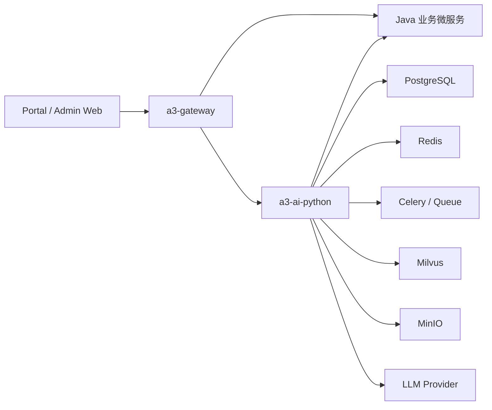

# A3 AI Service Architecture

## 定位

`a3-ai-python` 是独立于现有 Java 微服务的 AI 中台，负责承接 A3 赛题中最核心的智能能力：

- 对话式学生画像构建
- RAG 知识库检索
- 多智能体协同编排
- 个性化学习路径规划
- 多类型学习资源生成
- 学习效果评估与安全治理

## 总体架构

## 分层设计

### API Layer

- `chat`
- `profile`
- `plan`
- `resource`
- `evaluation`
- `admin`

### Application / Service Layer

- `ProfileService`
- `PlanService`
- `ResourceService`
- `EvaluationService`
- `ChatService`

### Agent Orchestration Layer

- `ProfileAgent`
- `RetrieverAgent`
- `PlannerAgent`
- `ResourceAgent`
- `EvaluatorAgent`
- `SafetyAgent`

### Knowledge Layer

- 文档接入
- 清洗切片
- Embedding
- Milvus 检索
- 引用回溯

当前第一版已经支持：

- 按课程维度创建 Milvus collection
- 课程详情切片入库
- 可配置 OpenAI 兼容 embedding 接口
- embedding 接口不可用时自动降级为稳定哈希向量
- `/ai/v1/rag/search` 检索接口

### Integration Layer

- Java 微服务客户端
- LLM Provider 适配层
- MinIO
- Celery

## 数据职责边界

### Java 微服务继续负责

- 用户、课程、题库、学习记录、推荐底座
- 认证、网关、消息、支付等原业务能力

### a3-ai-python 负责

- AI 对话会话
- 画像快照
- 学习计划
- 生成任务
- 知识库元数据
- 评估记录
- 审计日志

## 后续优先开发顺序

1. 打通环境与配置
2. 接入 Java 网关鉴权与内部调用
3. 完成课程知识库入库到 Milvus
4. 完成 LangGraph 主流程
5. 补多模态资源生成与安全治理
