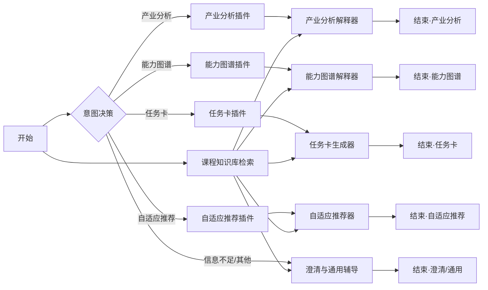

# 讯飞星辰工作流 V2 编排方案

目标工作流：`661895`（软件开发岗位能力自适应教练）

## 设计目标

把当前“开始 → 知识库/产业插件 → 通用大模型 → 结束”的单一路径，升级为按用户真实意图选择接口和输出协议的多路工作流。复杂度必须服务于准确性、可观测性和故障隔离，不为展示而堆节点。

## 目标拓扑

## 决策意图

1. `industry_analysis`：岗位趋势、产业需求、技能热度、专业群调整。
2. `ability_map`：能力图谱、能力维度、薄弱项、差距诊断。
3. `task_card`：训练计划、任务卡、实训任务、竞赛冲刺。
4. `adaptive_recommendation`：下一步学习、资源推荐、达标后的进阶或未达标补救。
5. 默认：目标、场景或期限不足时只提出 1—2 个必要问题；其他问题走知识库保守回答。

## 插件操作映射

- 产业分析：`GET /api/v1/xa/industry-analysis`
- 能力图谱：`GET /api/v1/xa/ability-map`
- 任务卡：`GET /api/v1/xa/task-cards`
- 自适应推荐：`GET /api/v1/xa/adaptive-recommendations`
- 演示默认参数：`user_id=1001`、`course_id=401`

## 工程约束

- 四个插件节点分别调用正确接口，不能让产业分析接口伪装成四种能力。
- 知识库与业务插件并行执行，降低总体等待时间。
- 每条业务支路仅运行一个专用大模型节点，避免多模型串行造成成本和超时。
- 每个插件和大模型节点启用 180 秒超时、1 次重试及结构化降级输出。
- 未执行的决策分支不得阻塞当前分支结束；采用独立结束节点避免跨分支变量汇聚歧义。
- 发布前至少覆盖五类调试用例，并保存每条支路最新 Trace。

## 回归用例

1. “分析软件开发工程师岗位最近需要哪些技能，并给出课程调整建议。” → 产业分析。
2. “展示我的岗位能力图谱和证据缺口。” → 能力图谱。
3. “我参加软件开发技能竞赛，3 天内强化测试用例设计。” → 任务卡。
4. “根据我上一轮任务表现推荐下一步学习。” → 自适应推荐；无历史表现时说明信息不足。
5. “我想提升软件开发能力。” → 默认澄清，仅追问场景和期限。

> 当前状态：设计已完成，等待 Chrome 控制连接恢复后在星辰画布实施；未发布。
